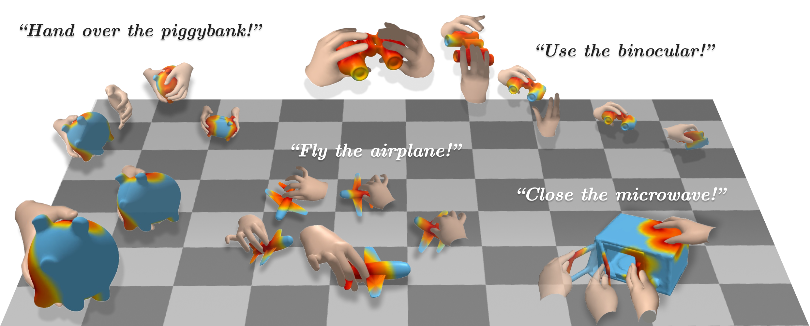

# JointHOI

Official research code for **JointHOI: Jointly Generating Contact Maps Enhances Hand–Object Interaction Generation** (**ECCV 2026**).



JointHOI is a single-stage diffusion model that jointly generates bimanual hand motion, object motion, and per-hand dynamic distance maps. The distance maps are treated as an inner modality rather than an external contact-map condition. During sampling, Contact Inner Guidance (CIG) uses a Log-L1 consistency energy between generated distance maps and distances implied by the generated geometry.

- Project page: <https://smk11602.github.io/JointHOI/>
- Paper: <https://arxiv.org/abs/2607.01768>
- Code: <https://github.com/smk11602/JointHOI>

## What is included

- Joint motion/contact denoiser
- Min-max-normalized, left/right distance-map data loader
- GRAB and ARCTIC training configurations
- DDIM sampling with Log-L1 Contact Inner Guidance
- Prompt-based sampling that does not depend on the evaluation pipeline

## Data, evaluation, and code base

We train and evaluate on the public [GRAB](https://github.com/otaheri/GRAB) and [ARCTIC](https://github.com/zc-alexfan/arctic) datasets. Raw/processed data and preprocessing code are not redistributed in this repository; see [docs/DATA.md](docs/DATA.md) for the expected processed-data format.

Our evaluation setup follows the public implementations from [BimArt](https://github.com/RosettaWYzhang/BimArt) and [IMoS](https://github.com/anindita127/IMoS). Evaluation code is not included in this release.

This repository is based on [Text2HOI](https://github.com/JunukCha/Text2HOI). We thank the authors of these projects for making their code publicly available.

Release TODOs:

- Pretrained weights and download links
- Visualization (see `visualize.py`)

## Environment

```bash
git clone https://github.com/smk11602/JointHOI.git
cd JointHOI
conda create -n jointhoi python=3.8
conda activate jointhoi
pip install torch==2.0.1 --index-url https://download.pytorch.org/whl/cu118
pip install -r requirements.txt
```

The command above installs the CUDA 11.8 build of PyTorch. Install the PyTorch build appropriate for your system if you use a different CUDA version.

Download the MANO model separately and set `mano_path` in the dataset config. The MANO files are not redistributable with this repository.

## Expected files

```text
data/
├── mano/
├── grab/
│   ├── data.npz
│   ├── obj.pkl
│   ├── text.json
│   ├── dmap_stats.npz
│   └── balance_weights.pkl
└── arctic/
    ├── data.npz
    ├── obj.pkl
    ├── text.json
    ├── dmap_stats.npz
    └── balance_weights.pkl

checkpoints/
├── grab/pointfeat.pth
└── arctic/pointfeat.pth
```

See [docs/DATA.md](docs/DATA.md) for the processed archive schema. Preprocessing is deliberately out of scope for this release.

## Training

Edit the paths in `configs/grab.yaml` or `configs/arctic.yaml`, then run:

```bash
bash scripts/train_grab.sh
bash scripts/train_arctic.sh
```

Configuration values can be overridden from the command line:

```bash
bash scripts/train_grab.sh train.batch_size=16 train.max_steps=1000
```

The model input at every frame is the concatenation

```text
[left-hand motion, right-hand motion, object motion,
 left-hand distance map, right-hand distance map]
```

No static/binary contact map (`cov_map`) is supplied as a condition.

## Sampling

Set a checkpoint path and edit the example prompt/object if needed:

```bash
CHECKPOINT=/path/to/grab_checkpoint.pth bash scripts/sample_grab.sh
CHECKPOINT=/path/to/arctic_checkpoint.pth bash scripts/sample_arctic.sh
```

Or call the sampler directly:

```bash
python sample.py \
  --config configs/grab.yaml \
  --checkpoint /path/to/model.pth \
  --prompt "Lift the mug with both hands." \
  --object mug \
  --hands both \
  --nframes 196 \
  --output outputs/sample.npz
```

The output archive contains left/right hand parameters, object parameters, normalized distance maps, and distance maps in meters. Add `--no-guidance` for unguided DDIM sampling.

## Citation

```bibtex
@inproceedings{song2026jointhoi,
  title={JointHOI: Jointly Generating Contact Maps Enhances Hand--Object Interaction Generation},
  author={Mingyeong Song and Jungbin Cho and Jisoo Kim and Ananya Bal and Kartik Sharma and Youngjae Yu and Laszlo A. Jeni and Junhyug Noh},
  booktitle={European Conference on Computer Vision (ECCV)},
  year={2026}
}
```

## License

The JointHOI source code is released under the [MIT License](LICENSE). Third-party code, datasets, models, and assets remain subject to their original licenses and terms. See [THIRD_PARTY_NOTICES.md](THIRD_PARTY_NOTICES.md) for details.
